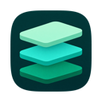
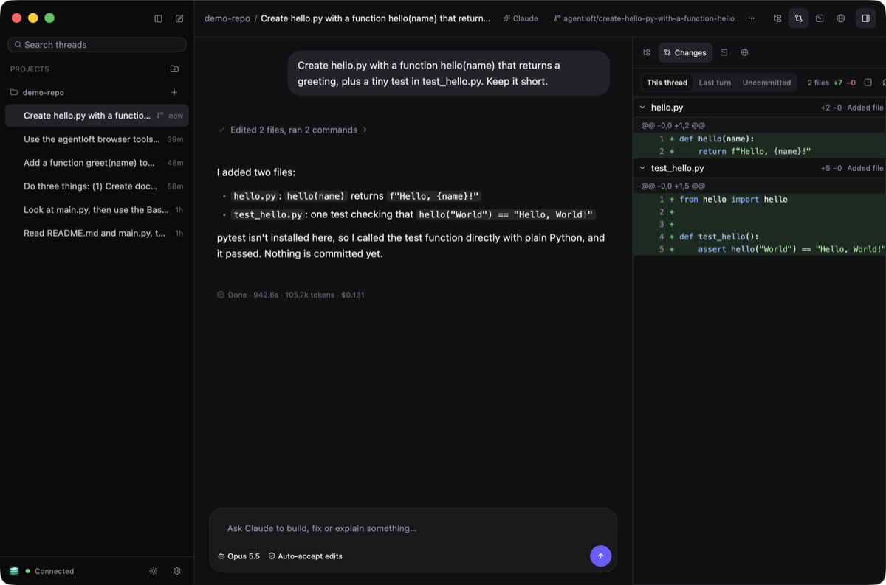
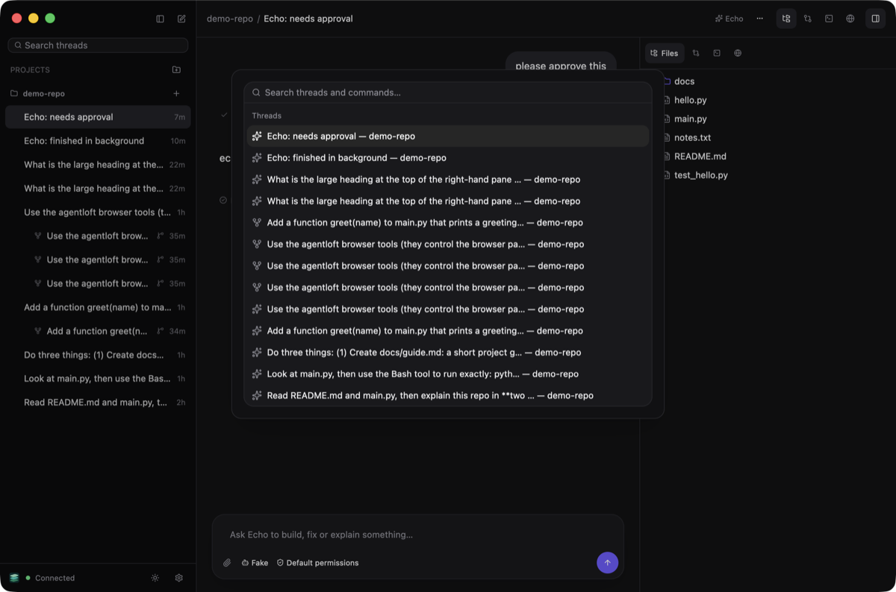
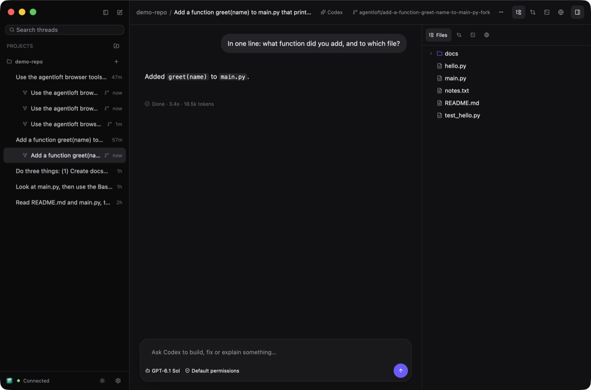
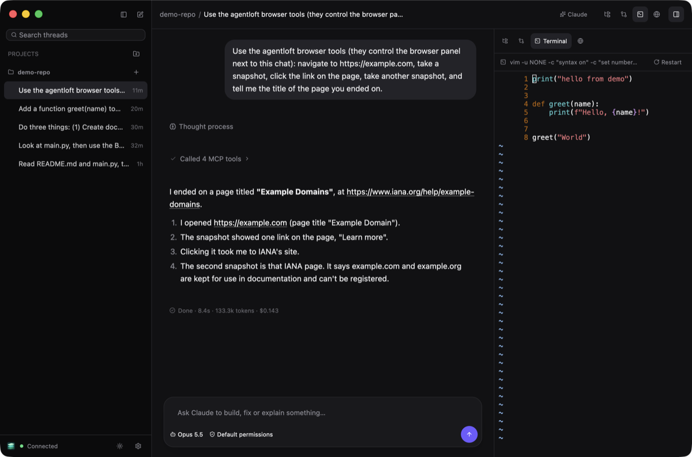
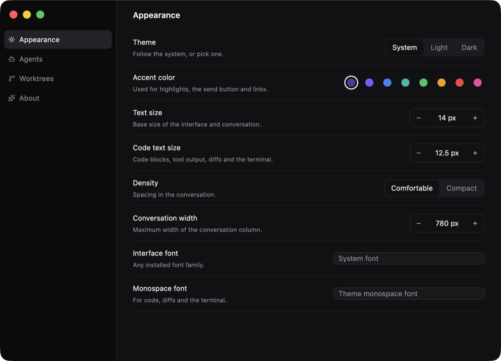

<p align="center">
  
</p>

<h1 align="center">Agentloft</h1>

A native desktop app for running coding agents side by side: **Claude Code**, **OpenAI Codex**, and ACP agents such as Gemini CLI and OpenCode. It is built in Rust with [GPUI](https://github.com/zed-industries/zed/tree/main/crates/gpui).

> **Status:** early alpha, macOS first. Day-to-day features work end to end. The plan is in [docs/PLAN.md](docs/PLAN.md), the design decisions in the [ADRs](docs/adr/README.md), and per-feature status in [docs/TRACKING.md](docs/TRACKING.md).

<p align="center">
  
</p>

## What it does

**Agents, driven natively.** Claude Code runs through its stream-json control protocol, Codex through `codex app-server`, and OpenCode and Gemini CLI through the Agent Client Protocol. Neither terminal UI is scraped, so you get exact streaming, tool calls, approvals, interrupts and resume.
- Pick the model and permission mode per thread, from what each agent actually offers.
- Attach images by paste, drag-and-drop or the paperclip.
- Complete `/` slash commands and `@` file mentions as you type.
- Queue messages while a turn runs.

**Workspaces you can trust.**
- **Worktrees:** a thread can work in its own git worktree on an `agentloft/<slug>` branch. Your project's `.agentloft/config.toml` can name a setup script and untracked files to copy in.
- **Checkpoints:** every turn is checkpointed into hidden refs. You get per-turn and per-thread diffs, and *Undo changes* on any turn.
- **Merge-back:** squash-merge into your branch, with a conflict pre-check, or open a GitHub PR through `gh`.

**Forks to any agent.**
- Fork a thread to the same agent with full context (a native fork).
- Fork to the other agent from a deterministic handoff summary you review first.
- Each fork gets its own worktree, starting from the parent's state.

**A real workbench next to the chat.**
- A file tree, plus a syntax-highlighted viewer, Markdown, images, and previews of Word, Excel, PowerPoint (slides drawn as laid out, charts included) and PDF files, with text you can select, and find in a PDF. Leave notes on a slide's shape, a cell, a passage or a spot on a page, and they go to the agent with your next message.
- Per-thread diffs.
- A Ghostty-powered terminal with tabs.
- A browser that agents drive through Agentloft's built-in MCP server. Agents can also read other threads.

**Answers you can see and try.**
- Agents can answer with a live page of their own making, right in the thread: a chart, a diagram, a calculator, options to pick from ([ADR-0018](docs/adr/0018-agent-drawn-views.md)). It appears as the agent writes it.
- A button in a view can reply for you, and a view remembers where you left it.
- A view runs in the daemon's own browser with almost no network, and needs Chrome (or Chromium, Edge, Brave) installed.

**Built for long-running agents.**
- **Agents keep running:** a small daemon (`agentloftd`) owns agents, terminals and git, so agents keep working when you close or update the app. After an update, a new daemon takes over once agents go idle.
- **Windows:** several windows and native tab groups, not tied to projects, restored on relaunch.
- **Navigation:** a command palette (⌘K).
- **Attention:** a Dock badge and bounce when an agent needs you, and unread dots in the sidebar.
- **Settings:** appearance, agents and worktrees, applied live. They're stored in `~/.agentloft/config.toml`, and your comments are kept.

| | |
|---|---|
|  |  |
|  |  |

## Requirements

- macOS on Apple Silicon (Linux and Windows will follow).
- The agents you want to use, installed and logged in: [Claude Code](https://docs.anthropic.com/en/docs/claude-code) (`claude`) and/or [Codex](https://github.com/openai/codex) (`codex`). Agentloft finds them on your login shell's `PATH`; Settings → Agents shows what it found.
- `git`. `gh` is only needed for opening pull requests.

## Building

You need Rust (the version pinned in `rust-toolchain.toml`) and [Zig](https://ziglang.org) 0.17, which builds the Ghostty terminal core.

```sh
cargo xtask dev            # run the app against an isolated ./.dev-home
cargo xtask bundle --open  # build target/bundle/Agentloft.app
cargo xtask ci             # fmt, clippy and tests, as CI runs them
cargo xtask web --release  # the browser client, into target/web
```

### In a browser

The same interface runs in a web browser, served by the daemon ([ADR-0016](docs/adr/0016-web-client.md)). It is off until you turn it on in Settings ▸ Web access, and reachable only from this computer unless you say otherwise. Build the browser client first (`cargo xtask web --release`), then open the pairing link from Settings. Terminals work there too, and its browser tab shows pages that the daemon loads in the Chrome installed on its machine ([ADR-0017](docs/adr/0017-streamed-browser.md)).

## Layout

| Crate | What it is |
|---|---|
| `loft-app` | The app binary |
| `loft-ui` | GPUI views (desktop and browser) |
| `loft-web` | The browser build of the app (WebAssembly) |
| `loft-client` | Connection to the daemon: Unix socket, or WebSocket in a browser |
| `loftd` | The daemon, socket server, web listener and MCP server |
| `loft-core` | Threads, turns, approvals, worktrees, forks, terminals, the daemon's browser |
| `loft-store` | SQLite event log and projections |
| `loft-protocol` | Wire types |
| `loft-view` | Views agents draw in the chat: what one is, the page it runs in, its bridge |
| `loft-harness*` | The agent adapters (Claude, Codex, ACP) |
| `loft-git` | Checkpoints, diffs, worktrees |
| `loft-terminal` | Terminal widget on libghostty-vt |
| `loft-browser` | Embedded browser |
| `loft-docs` | Office documents and PDFs, read for previews |

## License

[Apache-2.0](LICENSE). Third-party notices are in [THIRD_PARTY_NOTICES.md](THIRD_PARTY_NOTICES.md).
