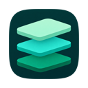
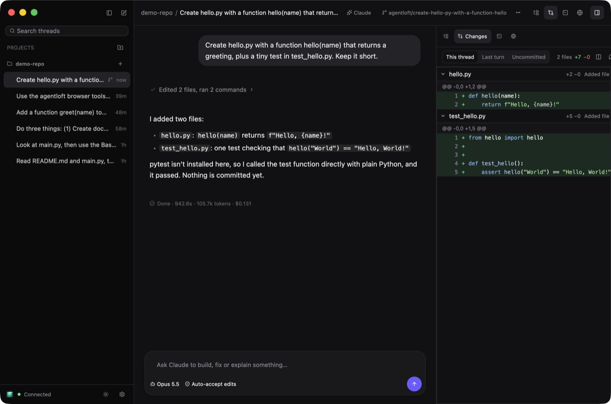
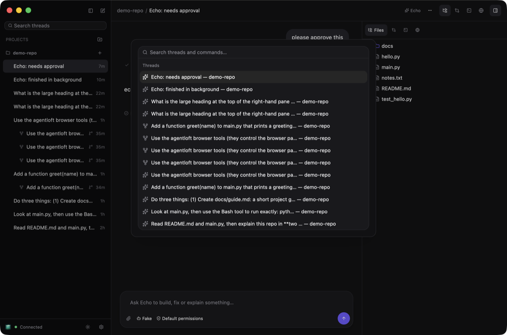
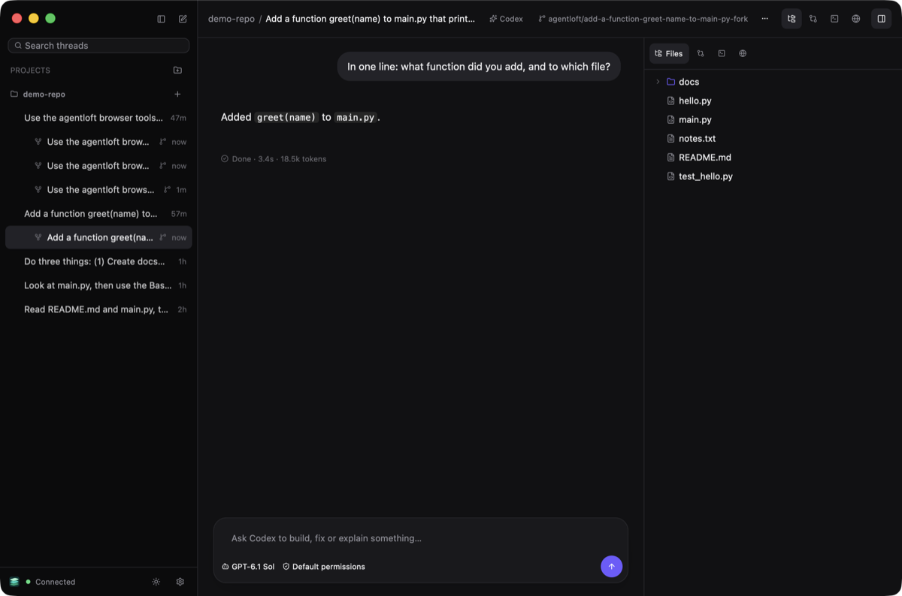
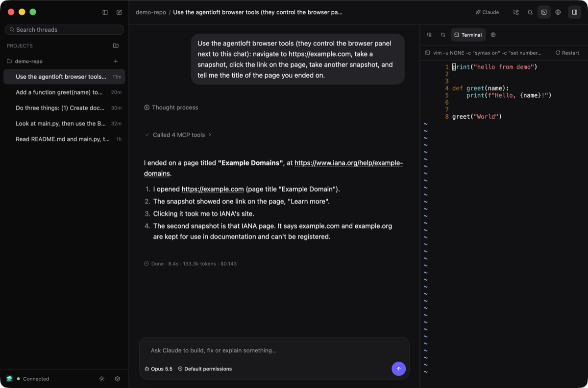
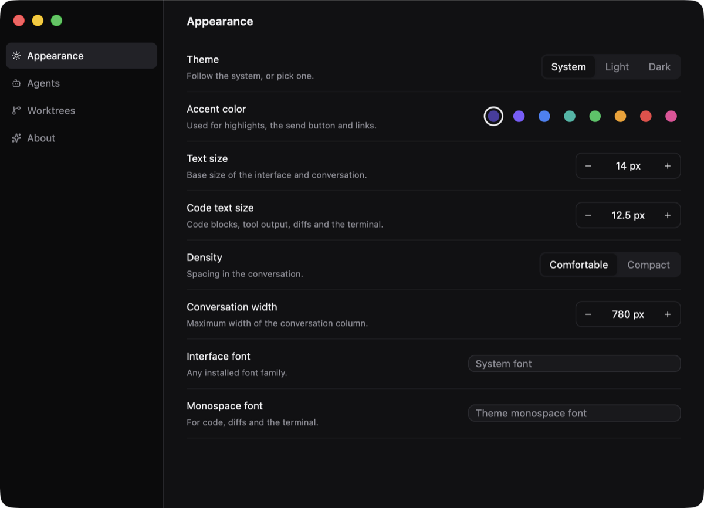

<p align="center">
  
</p>

<h1 align="center">Agentloft</h1>

<p align="center">
  <b>Run your coding agents side by side.</b><br>
  A native desktop app for Claude Code, Codex and ACP agents (Gemini CLI, OpenCode):<br>
  each thread with its own worktree, live diffs, a real terminal and a browser the agent can drive.
</p>

<p align="center">
  <a href="https://agentloft.promptanddone.com/">Website</a> ·
  <a href="https://github.com/agentloft/agentloft/releases/latest">Download</a> ·
  <a href="docs/PLAN.md">Plan</a> ·
  <a href="docs/adr/README.md">Design decisions</a> ·
  <a href="CONTRIBUTING.md">Contributing</a>
</p>

<p align="center">
  <a href="https://github.com/agentloft/agentloft/actions/workflows/ci.yml"></a>
  <a href="https://github.com/agentloft/agentloft/releases/latest"></a>
  <a href="LICENSE"></a>
</p>

<p align="center">
  
</p>

> **Early preview.** Agentloft is used every day on macOS, and everyday features work end to end. The Windows and Linux builds are new. Per-feature status is in [docs/TRACKING.md](docs/TRACKING.md).

## Why Agentloft

- **Many agents at once, none in your way.** Every thread can work in its own git worktree, so five agents can change the same project without tripping over each other or your working copy.
- **Agents driven properly.** Agentloft talks to each agent through its own structured protocol, never by scraping a terminal. You get exact streaming, tool calls, approvals, interrupts and resume, and your agents keep their own logins: Agentloft never sees an API key.
- **Everything to review the work, next to the chat.** Per-turn diffs and undo, a real terminal, file and document previews, and a browser you and the agent share.
- **Agents keep working when you close the window.** A small daemon owns the agents, so closing or updating the app doesn't stop them, and you can follow along from your phone.
- **Native and open source.** Rust and [GPUI](https://github.com/zed-industries/zed/tree/main/crates/gpui), GPU-rendered, Apache-2.0.

## Install

| Platform | Download | First launch |
|---|---|---|
| **macOS** (Apple silicon) | [Agentloft-macos-arm64.dmg](https://github.com/agentloft/agentloft/releases/latest/download/Agentloft-macos-arm64.dmg) | Drag Agentloft to Applications. The build isn't notarized yet: the first time, right-click the app and choose **Open** (or allow it in System Settings ▸ Privacy & Security). |
| **Windows** 10/11 (x64) | [Installer](https://github.com/agentloft/agentloft/releases/latest/download/Agentloft-windows-x64-setup.exe) · [portable .zip](https://github.com/agentloft/agentloft/releases/latest/download/Agentloft-windows-x64.zip) | Installs for your user, no administrator rights needed. If SmartScreen warns about an unrecognised app, choose **More info ▸ Run anyway**. |
| **Linux** (x64, glibc 2.35+) | [Agentloft-linux-x64.tar.gz](https://github.com/agentloft/agentloft/releases/latest/download/Agentloft-linux-x64.tar.gz) | Extract it and run `./agentloft/install.sh` (installs to `~/.local`), or run `agentloft/bin/agentloft` in place. |

You also need:

- **At least one agent, installed and signed in:** [Claude Code](https://docs.anthropic.com/en/docs/claude-code) (`claude`), [Codex](https://github.com/openai/codex) (`codex`), or an ACP agent such as Gemini CLI or OpenCode. Agentloft finds them on your `PATH`, and **Settings ▸ Agents** shows what it found.
- **`git`.** The GitHub CLI (`gh`) is optional: it is used for pull requests.
- **Chrome, Chromium, Edge or Brave** (optional) for the browser panel and agent-drawn views.

## Getting started

1. Open Agentloft and add a project: any folder, or a git repository.
2. Start a thread (<kbd>⌘N</kbd>), pick the agent, model and permission mode, and describe the task.
3. Watch the agent work. The **Changes** panel shows what it changed this turn or in the whole thread, the **Terminal** runs in the thread's folder, and the **Browser** shows what the agent opens.
4. Start more threads while that one works. Each can have its own worktree on an `agentloft/<name>` branch.
5. When a thread is done, squash-merge it into your branch or open a pull request.

Shortcuts are shown with ⌘ here; on Windows and Linux they use Ctrl. <kbd>⌘K</kbd> opens the command palette, which can do almost everything.

## What it does

### Agents

- **Claude Code** through its stream-json control protocol, **Codex** through `codex app-server`, **Gemini CLI** and **OpenCode** (and other agents) through the [Agent Client Protocol](https://agentclientprotocol.com).
- Model and permission mode per thread, from what each agent actually offers.
- Images by paste, drag-and-drop or the paperclip; `/` slash commands and `@` file mentions complete as you type.
- Queue messages while a turn runs: the daemon sends each one when the turn before it ends, whether the app is open or not.
- Mention another thread with `@` (or drag it from the sidebar onto the composer): the agent can read it.
- Quote a selection from the conversation (<kbd>⌘'</kbd>), or send a terminal selection as a code block.
- Usage limits: a thread that runs out of its plan's usage says when the limit resets, and can carry on by itself then.

### Workspaces you can trust

- **Worktrees.** A thread can work in its own git worktree. A project's `.agentloft/config.toml` can name a setup script and untracked files to copy in.
- **Checkpoints.** Every turn is checkpointed into hidden git refs, outside your history: diffs per turn or per thread, and **Undo changes** on any turn.
- **Merge back.** Squash-merge into your branch, with a conflict check first, or open a GitHub pull request. A worktree thread then shows its pull request, checks and review status, whoever opened it.
- **Project actions.** Name the commands a project runs often (`[[actions]]` in `.agentloft/config.toml`). They become buttons and palette entries, each running in its own terminal tab, with an optional preview URL for the browser panel.

### Forks

- Fork a thread to the same agent with its full context.
- Hand it to a different agent with a summary you review first.
- Each fork gets its own worktree, starting from the parent's state.

### A workbench next to the chat

- **Files and documents.** A file tree; a syntax-highlighted viewer; Markdown and images; previews of Word, Excel, PowerPoint (slides drawn as laid out, charts included) and PDF. Leave a note on a slide, a cell, a passage or a spot on a page, and it goes to the agent with your next message.
- **Terminal.** A real terminal, built on [Ghostty](https://ghostty.org)'s core, with tabs.
- **Browser.** A tab the agent drives through Agentloft's built-in MCP server ([ADR-0017](docs/adr/0017-streamed-browser.md)). You watch the same tab and can step in at any time.
- **Answers you can try.** Agents can answer with a live page of their own: a chart, a diagram, a calculator, options to pick from ([ADR-0018](docs/adr/0018-agent-drawn-views.md)). It appears as the agent writes it, and its buttons can reply for you.

### Built for long-running work

- **The daemon** (`agentloftd`) owns agents, terminals and git. Close or update the app and agents keep going; after an update, the new daemon takes over once they are idle.
- **Orchestration.** Agents can start threads of their own, wait for them and read their results. Stopping a thread stops the threads it started.
- **Automations.** Start a thread with a prompt on a schedule: every N minutes, daily, cron, or once.
- **Attention.** Unread dots in the sidebar, and a Dock badge when an agent needs you.
- **Windows and tabs.** Several windows and tab groups, restored on relaunch.
- **Settings** apply live, and are stored in `~/.agentloft/config.toml` with your comments kept.

| | |
|---|---|
|  |  |
|  |  |

## From your phone, or any browser

The same interface also runs in a web browser, served by the daemon on your computer ([ADR-0016](docs/adr/0016-web-client.md)). It is off until you turn it on in **Settings ▸ Web access**, and reachable only from your computer unless you allow more:

- **On your network:** open the pairing link (or scan its QR code) from Settings.
- **From anywhere:** in **Settings ▸ Web access**, choose **Link this computer** and approve it at [agentloft.promptanddone.com](https://agentloft.promptanddone.com/app). That's all: the computer goes online through a Cloudflare quick tunnel by itself. There's nothing to install (Agentloft fetches Cloudflare's `cloudflared` if you don't have it) and no Cloudflare account: Cloudflare gives the computer a random address, and the website keeps track of it. Then sign in with Google on the website and open your computer from any browser. That address only lets in browsers signed in through the website (pairing links don't work there), and Agentloft's traffic goes straight to your computer, not through the website. With a domain in your own Cloudflare account you can use a name under it instead ([ADR-0019](docs/adr/0019-website-and-cloudflare-tunnel.md)).

You can also open another computer's Agentloft over SSH: **File ▸ Connect to Another Computer…**.

## Build from source

You need Rust (the version pinned in `rust-toolchain.toml`) and [Zig](https://ziglang.org) 0.17, which builds the terminal core. On Linux, also GPUI's system libraries (listed in [`.github/workflows/release.yml`](.github/workflows/release.yml)).

```sh
cargo xtask dev            # build and run the app against an isolated ./.dev-home
cargo xtask bundle --open  # macOS: build target/bundle/Agentloft.app
cargo xtask ci             # fmt, clippy and tests, as CI runs them
cargo xtask web --release  # the browser client, into target/web
```

On Windows and Linux, `cargo build --release -p loft-app -p loftd` builds `agentloft` and `agentloftd`; put the browser client's `target/web` folder next to them. [CONTRIBUTING.md](CONTRIBUTING.md) covers the architecture rules and keeping builds fast.

## How it fits together

```
 Agentloft app (GPUI)  ─┐
 Browser / phone        ├─►  agentloftd  ─►  Claude Code · Codex · ACP agents
 Another computer (SSH) ┘        │              git · terminals · headless Chrome
                                 └─►  SQLite event log (~/.agentloft)
```

The app never spawns processes or touches the database: everything goes through the daemon, over a local socket (a named pipe on Windows), a WebSocket from a browser, or SSH.

| Crate | What it is |
|---|---|
| `loft-app` | The app binary |
| `loft-ui` | GPUI views (desktop and browser) |
| `loft-web` | The browser build of the app (WebAssembly) |
| `loft-client` | Connection to the daemon: Unix socket (a named pipe on Windows), or WebSocket in a browser |
| `loftd` | The daemon: socket server, web listener, MCP server |
| `loft-core` | Threads, turns, approvals, worktrees, forks, terminals, the daemon's browser |
| `loft-store` | SQLite event log and projections |
| `loft-protocol` | Wire types |
| `loft-view` | Views agents draw in the chat: what one is, the page it runs in, its bridge |
| `loft-harness*` | The agent adapters (Claude, Codex, ACP) |
| `loft-git` | Checkpoints, diffs, worktrees |
| `loft-terminal` | Terminal widget on libghostty-vt |
| `loft-browser` | Embedded browser |
| `loft-docs` | Office documents and PDFs, read for previews |

## Contributing

Issues and pull requests are welcome. Read [CONTRIBUTING.md](CONTRIBUTING.md) first; the plan is in [docs/PLAN.md](docs/PLAN.md), and why things are the way they are is in the [ADRs](docs/adr/README.md).

## License

[Apache-2.0](LICENSE). Third-party notices are in [THIRD_PARTY_NOTICES.md](THIRD_PARTY_NOTICES.md).
